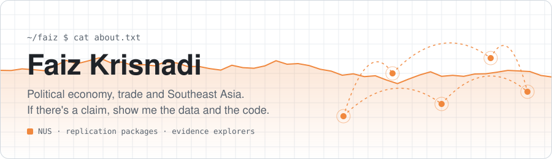
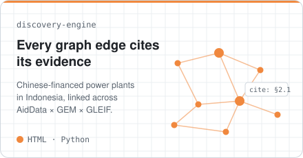
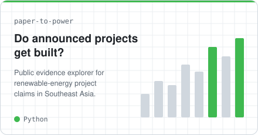
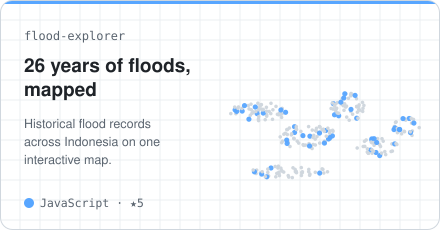
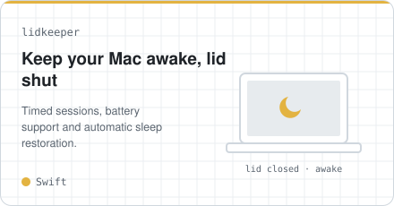
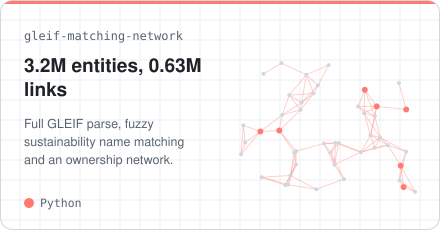

  

  
  
  

I'm a political economist who builds things to check claims. I study global trade, Southeast Asian political economy and China's economic engagement in the region, and I care about how narratives and incentives shape policy. My rule: if there's a claim, I want the data and the code that led to it.

### Building now

  
  
  
  
  
  

### Research you can rerun

| Repo | What's inside |
| --- | --- |
| [master-thesis](https://github.com/FaizKrisnadi/master-thesis) | Replication package for my NUS master's thesis |
| [trade-dispute-viid-dataset](https://github.com/FaizKrisnadi/trade-dispute-viid-dataset) | Data and analysis for the VIID paper on trade disputes and forum shopping |
| [nlp-thesis](https://github.com/FaizKrisnadi/nlp-thesis) | Can a transformer learn my thesis labels? |
| [behavioural-ai-research](https://github.com/FaizKrisnadi/behavioural-ai-research) | Exercises on AI agreement, interpretation and user influence |
| [galaxy-of-ai](https://github.com/FaizKrisnadi/galaxy-of-ai) | A library of AI and its links to infrastructure, governance and economics |

### Tools

<b>research</b>&nbsp;    

<b>build</b>&nbsp;    

<b>agents</b>&nbsp;   

Open to research collaborations on trade, energy finance and Southeast Asia. Say hi on X.
